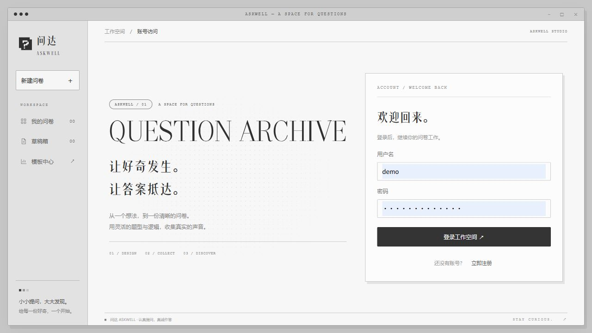
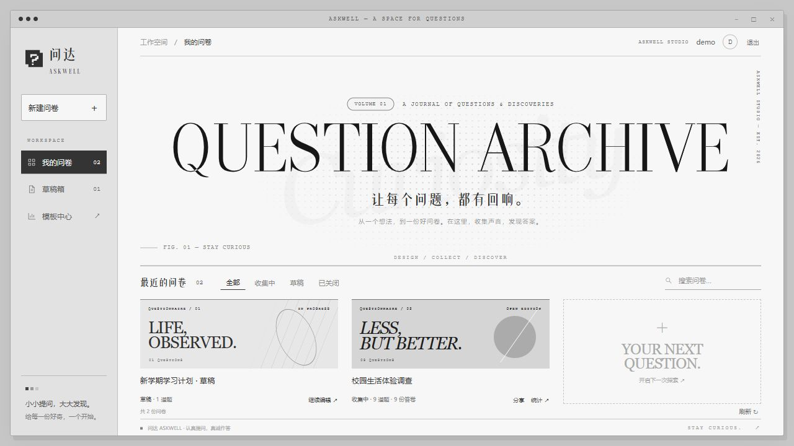
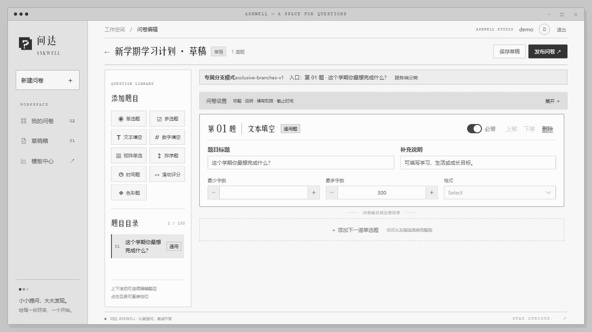
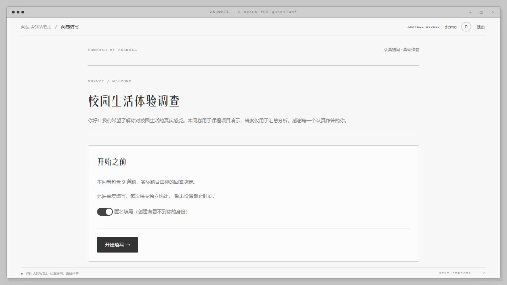
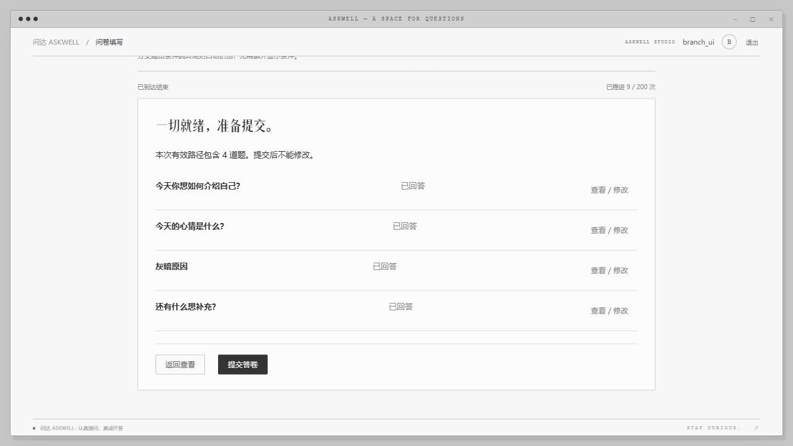
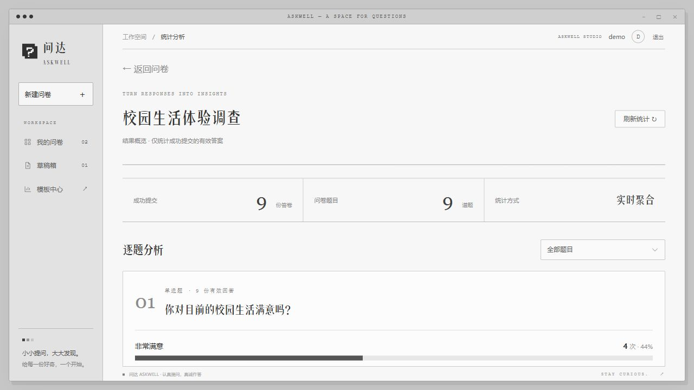

# 前端页面操作指南（杂志风）

当前项目只有一套运行前端。按 [README启动步骤](../README.md) 启动后，打开 http://127.0.0.1:3000。本文使用现有实际页面截图，示例内容和数量以截图时为准，不作为本轮用户人工测试通过的依据。

## 1. 注册与登录

输入账号和密码，点击“登录工作空间”；没有账号时点击“立即注册”。演示账号见README。登录后只能管理自己的问卷。

## 2. 工作台：新建、草稿、分享和统计

左侧“新建问卷”开始创建；“草稿箱”定位未发布问卷。问卷卡片的“继续编辑”打开草稿；发布后使用“分享”复制填写链接，“统计”进入结果页。搜索和状态筛选在列表上方。

## 3. 编辑、保存和发布

左侧题型按钮添加题目，题目目录用于定位。右侧设置标题、说明、必答、选项及题型校验。展开“问卷设置”配置标题、填写权限等。右上角先“保存草稿”，完成后“发布问卷”；发布后定义锁定。

通用题／分支题标识自动计算。条件跳转的所有非END目标都是分支题；规则未命中时只进入后面的通用题。没有通用题时不能发布。当前页面不提供显示条件开关，也不需要逐份点击升级。旧系统数据维护步骤见 [统一迁移说明](系统统一分支机制迁移.md)，不是日常填写操作。

## 4. 分享与填写

创建者在工作台点“分享”获得 `/survey/:publicId` 链接；填写者登录后开始，允许匿名的问卷可选择匿名。逐题输入并确认，非法输入会提示错误。

完成后展示当前有效路径。可以“查看／修改”已经访问的题，单纯返回不删除答案；确认改答才重新计算路径。新分支须补答，完成后点击“提交答卷”。

关掉浏览器页不会关闭问卷；未确认输入可能丢失。后端及数据库需要运行，127.0.0.1仅在本机可访问。系统中的“关闭问卷”代表停止收集，与关闭浏览器标签页不同。

## 5. 查看统计

创建者在工作台点“统计”。页面显示正式提交数量、逐题统计，并可筛选单题；填空内容按接口分页读取。未提交的填写过程和被清理的分支答案不计入统计。

## 用户人工测试记录

用户已完成5份正式答卷并提供统计结果，实际路径及只读复核见 [人工测试数据与记录](人工测试数据与记录.md)。错误密码截图与非法输入的具体人工证据仍待补充；本指南图片是既有操作示意，不替代这些证据。
