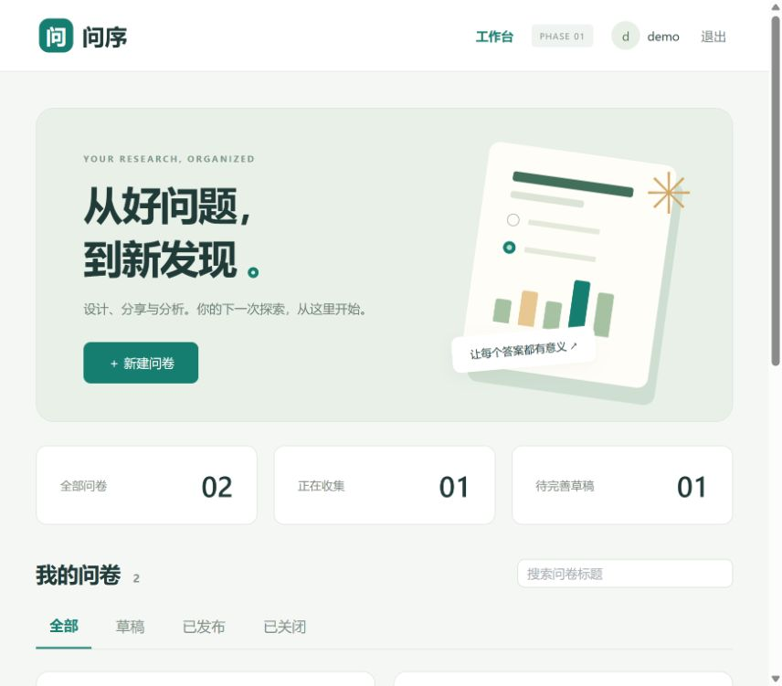
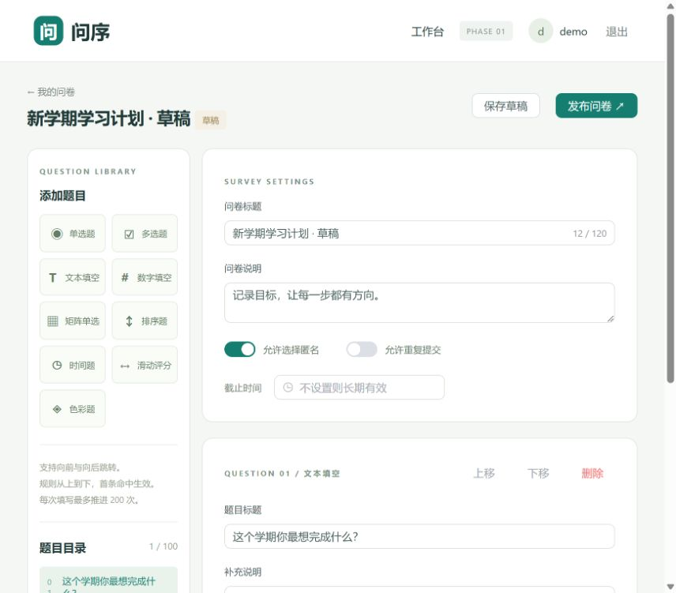
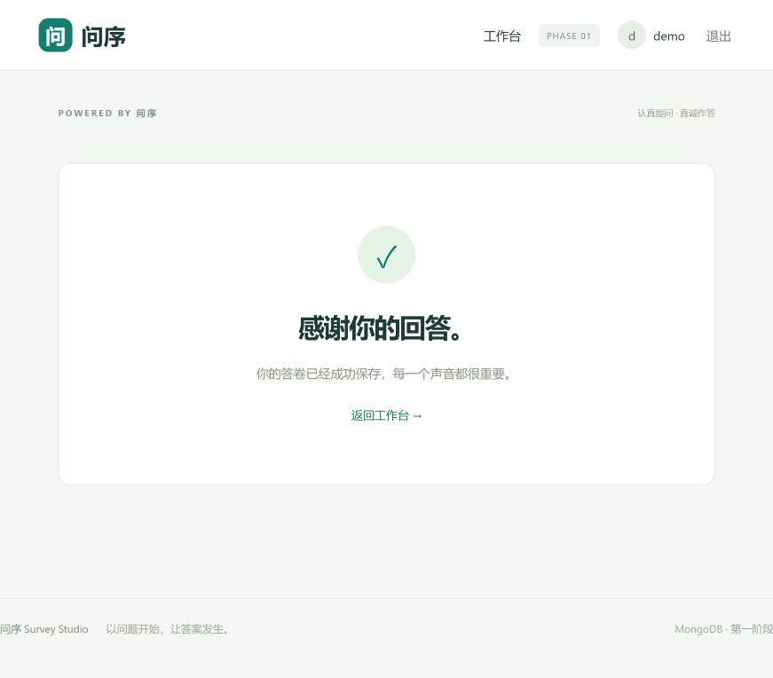

# 第一阶段项目完成报告

项目：基于 MongoDB 的问卷系统——问达 ASKWELL（早期名称问序 Survey Studio）

日期：2026-10-22。报告作者信息请由提交者填写。本报告描述实际交付内容，不包含尚未公布的第二阶段功能。

## 一、项目目标与需求确认

实现注册用户设计、发布、分享问卷，登录填写者按校验及条件路径回答，创建者查看汇总统计。评分重点为 MongoDB 建模、后端逻辑、测试、文档和真实 AI 使用记录。

用户明确选择 Vue 3 + NestJS + TypeScript；登录后可选择匿名；默认每账号一份、创建者可允许多次；允许向前跳及循环；首条规则优先；发布后锁定；手机号使用文本校验。随后确认单次填写最多200次推进，并扩展矩阵单选、排序、时间、滑动评分、色彩题，其专属条件跳转不在第一阶段范围内。

## 二、系统设计及实现

单体前后端分离开发，同源构建交付。Vue 3 提供账号页、问卷工作台、编辑器、填写与结果页；NestJS 提供账号、管理、填写、提交与统计接口。MongoDB 为唯一业务数据存储。

代码分层：HTTP入口、业务服务、领域规则、数据库模型。题目配置、校验和跳转均来自问卷定义，程序执行通用规则，不硬编码某份问卷的题目和答案。

工作台只展示本人问卷。编辑器支持九题型参数、题目与规则排序、发布、截止时间和关闭。填写时可恢复已保存过程，非法输入由后端拒绝并展示提示。最终提交采用事务并限制重复。

## 三、MongoDB 设计

采用 users、surveys、survey_versions、response_attempts、responses、submission_claims、sessions、auth_throttles 八个集合。有限规模且共同读取的题目、选项和规则嵌入问卷定义；答卷和填写过程独立增长，单独存储。

surveys 保留可编辑草稿，survey_versions 保存不可变快照，responses 引用明确版本。重复的草稿与快照是有意保留的生命周期隔离；统计不额外冗余选项计数。稳定 ID 避免题序变化破坏跳转引用。

用唯一索引保证用户名、公开标识、版本、单次填写答卷及每账号名额唯一。TTL清理7天会话/填写过程；业务仍检查过期时间。集合 JSON Schema 约束顶层结构，领域校验负责动态字段、范围和跨题引用。详细字段与索引见《数据库与系统设计》。

与关系数据库相比，本项目不需要为各题型校验拆出大量关联表，嵌套定义与异构答案更贴近文档结构。关系数据库仍能实现该业务，本项目选择 MongoDB 是匹配课程要求与聚合读取模式。

## 四、跳转设计

单选eq、多选any/all/exact、数字比较/闭区间，按规则顺序首条生效。未命中进入顺序下一题，末题到END。条件规则实际循环时截断有效路径、保留目标题当前答案、删除后续旧答案；每题只保留一份最终答案。主动返回则仅移动游标，确认改答后重新计算有效路径，保留重合答案，只清理失效分支；新分支要求补答后才可提交。

循环允许发生，但推进计数不可通过返回重置。第200次到END允许提交，仍未结束则禁止继续推进；180次起提醒。最终提交重新检查后端保存的路径、答案、结束状态及数量上限，防止客户端伪造。

## 五、校验设计

发布前校验题目范围、ID、选项、数字限制、跳转引用和运算符。填写时按题型校验必答、合法选项、数量、文本长度/手机号、数值范围/整数、矩阵各行、完整排序、时间格式/边界、评分步长、颜色格式。

可选题整题空值不写答案；跳过题不参与必答检查。前端用于交互提示，后端承担最终可信校验。时间题的日期和时刻使用字符串；日期时间规范化为UTC ISO字符串，界面固定上海时区，系统时间用BSON Date。

## 六、一致性、匿名和权限

发布和提交使用 MongoDB 事务。提交时在同一事务中争抢限次占位、写答卷、结束填写并清理匿名身份。对问卷文档的事务写入，使关闭与提交形成冲突序列。草稿和填写使用 revision 乐观锁。

匿名针对创建者：匿名答卷无 respondentId，完成过程移除 userId；未完成过程、限次占位与短期幂等收据仅后端可读。管理员层面不承诺完全不可关联。非匿名身份不通过统计内容接口泄露。

密码使用scrypt随机盐哈希，登录令牌使用随机值且只存哈希；Cookie设置HttpOnly/SameSite。管理接口逐次检查ownerId，填写接口检查userId。部署在127.0.0.1供本机演示。

## 七、统计设计

MongoDB按需聚合成功提交答卷。选择题计数；矩阵按行列分布；排序平均名次、首选次数及名次分布；数字和评分平均值；时间与色彩按值计数；填空内容分页。跳过和清除答案不计入，重复允许时每份答卷独立统计。无数据平均值返回null。

## 八、AI使用过程与人的贡献

使用Codex对话与编程工具完成方案、源码、测试、演示数据和文档，未使用现成问卷框架。用户提供课程要求并决定技术栈、匿名、限次、前跳语义、200次上限及新增题型范围。AI提出建模和工程实现，通过运行测试验证并修正生成内容。

真实错误包括类型推断、Mongoose省略空对象导致数据库验证失败、Vue代理对象复制方式不当，以及构建环境异常。具体提示词、产出和修正见《AI使用日志》。本报告不虚构学生手工编写的代码；提交者应补充自己实际阅读、运行、理解和修改的内容。

## 九、测试及问题解决

已执行17项规则自动测试和10组真实数据库API集成测试并通过。覆盖指定创建、添加题目、跳转、校验、提交、统计六类，以及匿名、越权、并发和事务回滚。测试用例包含步骤、输入、预期输出与结果，原始结果随项目保存。

数据库环境问题：现有MongoDB是独立实例，不能满足多文档事务，因此使用项目专属Docker MongoDB 7副本集，绑定27018，不改已有27017实例。

数据验证问题：空答案对象被Mongoose自动省略，与集合必填结构冲突；关闭自动省略后通过真实数据库复测。

前端问题：生成代码的代理对象复制和类型声明问题已修正；构建异常及最终结果如实记录在测试报告。

## 十、阶段二基础与当前限制

后续在本项目核心结构上扩展，不删除旧数据和主要功能。schemaVersion支持答案结构演化；发布版本和稳定ID支持新增发布版本；本阶段测试作为回归基础。需为第二阶段新增“需求—问题—结构变化—代码调整—兼容性—回归结果”记录。

当前规模适合课程演示：问卷最多100题、选项/矩阵行最多30项；列表最多500份；统计未缓存；同问卷提交竞争一份问卷文档。没有实现生产部署、密码找回、文件上传、游客填写或发布后改题。排序名次聚合目前收集positions数组，大规模答卷时应改为数据库直接分桶，避免过大聚合结果。项目强调先正确实现课程需求，再根据真实新需求迭代。

## 十一、初始交付验证（历史记录）

最终采用项目本地 Node.js 22.23.4，完整前后端构建成功；17项规则测试和10组真实数据库接口测试全部通过。集成测试还验证提交收据不能用作登录Cookie。原始输出保存在test-results目录。

浏览器已完成九题型匿名填写、必答错误提示、返回修改清除后续答案、成功提交、草稿刷新恢复、统计内容查看及矩阵单题筛选。演示问卷初始生成8份样本，浏览器验收增加1份，当前共9份。第一阶段应用已启动在本机3000端口。

实际界面：

## 十二、主动改答增量（2026-10-22）

用户提出普通改答不应清除无关联答案，因此将主动返回修改与条件循环跳转分开处理。当前返回只改变显示游标，已确认答案和完成路径不变；确认修改后按后端保留答案重算路径，清理失效分支，保留重合答案。新分支尚未回答时暂停并隔离可能汇合的旧答案，补答后再决定恢复或丢弃；真正条件循环仍保留目标题旧值并截断后续。

新增查看模式、确认集合和候选答案区，旧记录按需兼容，不改已有答卷和问卷版本。保留权限、乐观锁、事务、幂等和200次上限，前端只同步填写行为，保留用户设计。完整构建通过；本次32项规则测试和16组真实MongoDB接口测试通过，包含原有工作台计数用例。本轮未执行新的浏览器人工验收。

接口仍使用原back/advance/submit，请求字段不变；ready与显示游标分离。详细对接和证据见《改答逻辑增量说明》。旧提交包与阶段一校验清单保留为初始快照，当前源码包含后续前端及本次改答更新。

## 十三、自动专属分支与语义模式增量

最新用户决策取代独立显示条件：所有非END规则目标自动成为专属分支；未命中只进入后续通用题，命中直接进入目标，分支不自动组成题组。统一领域计划同时用于入口、推进、重算、图可达性和提交，不提供顺序进入分支的例外。

保留schemaVersion=1，新增routingMode分别解释legacy-v1和exclusive-branches-v1。缺标记的历史快照仍按旧算法，新的草稿默认新模式，旧草稿需要先审阅分支和入口后明确升级，发布固定模式。旧答卷和在途填写继续引用原版本，不批量改写。

本次52项规则测试与26组真实数据库接口测试通过，完整构建通过。已核验A/B/C/D新路径、旧A/B路径仍保持、升级确认/冲突/权限、历史数据不变及原有安全功能。分类接口、前端契约、示例JSON和草稿只读预览已交付；后续前端已完成分类徽标和升级弹窗，当前55项自动测试及26组数据库测试通过，详见《前端专属分支接入验收》《发布检查记录》，不增加显示条件开关。详情见《专属分支与模式升级说明》。
